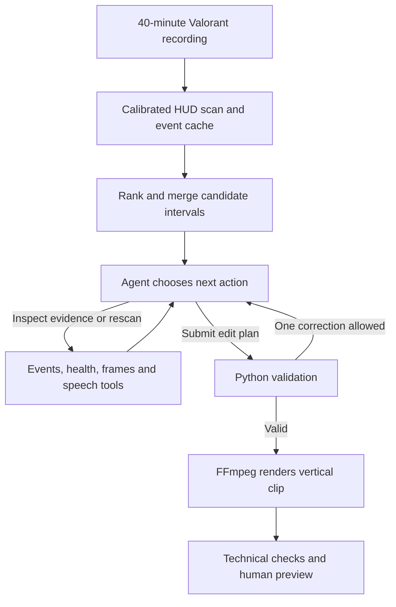

# Valorant StoryClip — mini-project build plan

Prepared 14 October 2026. Deadline: tomorrow, 15 October 2026, India time.

Scope update: the user now wants a whole-match story lasting up to three minutes as an additional primary output. MATCH_STORY_PLAN.md describes the proposed timeline, storyboard, and multi-scene rendering extension. The current implemented output remains a single encounter; the two scopes require different selection and duration rules.

Build an application that takes a locally downloaded 40-minute Valorant gameplay recording, extracts candidate game events from calibrated HUD regions, uses a language-model agent to select and refine one interval, and exports a vertical clip. First test Pi with the user's existing ChatGPT Plus subscription as the preferred inference connection. Retain the installed Ollama option as a backup; OpenRouter remains an alternative. The engineering contribution is event detection with explicit uncertainty, evidence-based selection, the tool-use loop, validation, and measurable comparison with a simple baseline.

Implementation has begun. The first prototype now scans the supplied full match, supports Pi agent tool requests for event/health records and sampled frames, and exports a validated vertical MP4. See README.md and RUN_STATUS.md for the implemented scope and measured results; later sections include planned extensions.

## 1. Scope that fits the deadline

Known constraints: beginner developer; RTX 3070 with 8 GB VRAM; no API budget; user will obtain a full gameplay recording from YouTube locally; Gemma is already installed. Plan for approximately 8–10 focused hours, including setup and presentation preparation. This is an estimate; transcription downloads, provider availability, and machine compatibility are the main early uncertainties.

**Input:** one local 40-minute MP4 downloaded by the user; the exact video has not yet been chosen. Recommend a single player's unedited first-person match with a consistent, readable HUD and preferably commentary. Develop and validate detectors on a 1–2 minute excerpt before scanning the full recording. Start with one spoken language and test whether transcription handles it. A run restricted to an excerpt must disclose that scope.

**Output:** one continuous 30–60 second MP4, targeting 45 seconds, on a 720 × 1280 vertical canvas; a preview; source timestamps; a short evidence-based selection explanation; and an agent action log. Add speech captions after the basic clip works. Preserve the original chronological order.

**A successful demonstration:** the system selects a plausible interesting interval, retains enough surrounding footage to understand it, exports a playable clip, and shows how the agent used tools or corrected its plan. Human review verifies the actual gameplay outcome.

The prototype estimates an interesting, coherent moment. It does not establish the objectively best highlight in an entire match. Tomorrow's visual scope is a detector calibrated to one recording's HUD. General gameplay recognition, automatic zoom tracking, multi-game support, multi-clip montages, deployment, and automatic social-media uploads are later extensions.

## 2. Get suitable footage first

The user will download a full gameplay recording from YouTube. Choose a single-player perspective with clear commentary, a readable HUD, and both ordinary gameplay and interesting encounters. Avoid an already edited highlights montage: its creator has already performed the selection our project should demonstrate. Review one minute to check audio clarity. Save the source URL and creator name with the run metadata for attribution and reproducibility.

A useful story could be: preparing to defend a site → an encounter → its outcome and reaction. Success is not necessary: a failed attempt can still make a complete story. Avoid depending on obtaining a rare ace tonight.

Do not fabricate transcript evidence or present a manually selected interval as an autonomous choice. A shorter development excerpt is acceptable if its limits are explicitly identified.

Privately mark two or three worthwhile moments for evaluation. Keep these manual marks out of the agent's inputs.

## 3. Stack and feasibility gate

| Component | Choice | Purpose |
|---|---|---|
| Application | Python | Coordinates files, model calls, and checks |
| Media tools | FFmpeg and ffprobe | Inspect media, extract audio, trim, resize, and render |
| Event extraction | OpenCV plus Tesseract OCR | Reads calibrated kill-feed and health regions |
| Speech recognition | faster-whisper, small pretrained model | Produces timestamped speech segments |
| Preferred model connection | Pi with ChatGPT subscription login | Selects candidates and requests context within existing plan usage |
| Alternative hosted connection | A tested, explicitly free OpenRouter model | Provides the same decision interface if needed |
| Local backup | Installed Ollama `gemma4:e4b` | Runs the same agent interface locally |
| Agent control | Small Python state machine | Executes permitted actions and limits retries |
| Output validation | Pydantic plus ordinary Python checks | Validates model response structure and edit bounds |
| Interface | Streamlit | Select recording, run, preview, and download |
| Storage | Local files and JSON | Keeps artifacts and decisions inspectable |

**Pi and the existing ChatGPT Plus subscription:** Current OpenAI documentation lists Pi as an open-source Sign in with ChatGPT integration. Eligible Plus/Pro users can enable plan usage for supported tools, and OpenAI documents personal projects that run locally as eligible integrations. Usage counts toward the existing plan allowance; this is not a new unlimited allowance. Pi version 0.87.1 is installed in this workspace. Authentication and completed inference have not been tested. [Supported integrations and usage](https://learn.chatgpt.com/docs/sign-in-with-chatgpt), [personal local projects](https://developers.openai.com/cookbook/articles/sign-in-with-chatgpt)

Start Pi interactively, use `/login`, choose the ChatGPT/Codex subscription sign-in option, and complete browser authorization. Select a model available to that connection and verify one small request. Keep authentication with Pi; Python does not need to copy OAuth credentials. Pi supports noninteractive output and a JSONL RPC interface for integration with other languages. [Pi integration modes](https://github.com/earendil-works/pi/blob/main/packages/coding-agent/README.md), [RPC documentation](https://github.com/earendil-works/pi/blob/main/packages/coding-agent/docs/rpc.md)

For tomorrow, the simplest proposed adapter invokes Pi in noninteractive JSON mode with its general-purpose tools disabled, supplies the current evidence and requested action schema, and extracts the final model message from the event stream. Python validates the action, runs only the project's permitted tools, and sends actual tool results back on the next turn. Each request must include the bounded state needed for that turn. This keeps the existing controller and evidence log useful. A later Pi extension could register the clip tools directly, but is not required for the first integration. Pi's JSON event stream is not itself an edit-plan object: the adapter must extract and validate the model's payload.

The feasibility gate is one successful authenticated request and one valid candidate selection from sample evidence. A model shown in a picker is not proof that inference is available. Measure actual latency and keep the same turn/retry limits. No installation, sign-in, or subscription inference was performed as part of writing this plan.

No new Qwen download is required. A read-only `ollama list` check confirmed `gemma4:e4b` (9.6 GB on disk), `qwen2.5:7b-instruct` (4.7 GB), and `qwen3.5:9b` (6.6 GB). Disk size is not the exact runtime VRAM requirement, but Gemma's size means a full-GPU fit on 8 GB must not be assumed. Test a short prompt and measure latency. If Gemma is too slow, the already installed 7B Qwen is another local option.

Ollama documents Gemma 4's image input and agent capabilities. Optional shortlisted-frame inspection is possible after the text workflow works; model capability does not establish reliable Valorant event recognition. Do not expand tomorrow's MVP into full-video visual inference. [Gemma model documentation](https://ollama.com/library/gemma4:e4b)

OpenRouter currently lists 50 requests per day on its free tier. Free endpoints can also hit upstream capacity limits. Prefer a specific tested free model ID for repeatable runs; the `openrouter/free` router selects among available free models, so record the actual returned model if using it. Send concise candidate evidence, not the full recording. Cache successful decisions, cap retries, and keep the installed local option available. A free model is a candidate to test, not a proven quality improvement. [Free-tier pricing](https://openrouter.ai/pricing), [rate limits](https://openrouter.ai/docs/api_reference/limits), [free router](https://openrouter.ai/docs/guides/routing/routers/free-router)

Initially run transcription on CPU with int8 computation. If using local inference, run Ollama separately and measure its memory use. faster-whisper documents CPU/int8 and timestamped transcription. This avoids making CUDA integration for two inference systems a prerequisite. [faster-whisper documentation](https://github.com/SYSTRAN/faster-whisper)

The current workspace exposes Python and Ollama commands, and the Ollama service answered the model inventory check. FFmpeg and ffprobe were not found in the command path. GPU inference and model latency have not been tested.

Start any transcription-model download early. Timebox a smoke test to about 30 minutes after setup: read health and detect a known player kill in a representative sample; transcribe one minute if commentary is available; obtain one valid selection from three sample candidates using the chosen provider; render a ten-second vertical clip. If testing OpenRouter and local inference, reuse the same sample evidence. Check captions separately if supported by the FFmpeg build. Do not promise processing speed or model quality until measured.

## 4. Workflow

**Candidate discovery:** scan the full recording for attributed player-kill events using calibrated kill-feed regions, local template/color checks, and OCR when useful. Derive clusters of nearby kills, then inspect health around those events to identify low-displayed-HP candidates. Audio activity and speech provide additional proposals. Merge overlapping windows, preserve distinct encounters, and retain approximately 5–10 candidates. Keep a few audio/context candidates so an event detector miss does not automatically exclude every non-kill story. The sampling rates, thresholds, and shortlist sizes are proposed starting settings that must be validated on the chosen video.

**Initial boundaries:** propose approximately 15 seconds before and 30 seconds after an anchor, clamped to the source duration. These are starting parameters to inspect on the recording, not universal rules.

**Agent selection:** give the model candidate IDs, original-file timestamps, event summaries, health evidence, short transcript excerpts when available, and detector quality flags. Ask it to prefer a comprehensible setup, an interesting change, and a supported outcome. It can inspect cached events, request a denser local rescan, inspect adjacent context, select another candidate, or submit a final interval. A frame inspection request is useful only if the selected model connection supports images; otherwise show the evidence in the human preview.

**Story preservation:** begin early enough to show the situation and end late enough to include the resolution or reaction. A contiguous interval makes this easier than assembling several disconnected moments. If evidence is insufficient, return a low-confidence candidate for review instead of claiming a complete story.

**Rendering:** keep the full landscape gameplay frame, scaled proportionally inside the portrait canvas with padding. Use spare space for a brief title and captions. This preserves the HUD and peripheral action, though the gameplay will appear smaller than a full-screen crop. Verify readability on a phone-sized preview. FFmpeg documents the required trim, scale, pad, and subtitle filters. [FFmpeg filter reference](https://ffmpeg.org/ffmpeg-filters.html)

## 5. What makes this agentic

One agent is enough. Its goal is to choose a coherent highlight under duration constraints; it chooses actions based on evidence and receives tool feedback. A fixed pipeline that always performs the same steps cannot demonstrate this adaptive choice on its own.

Expose only these actions:

| Action | What Python does |
|---|---|
| `get_candidates(limit)` | Returns the ranked cached shortlist and its evidence IDs |
| `get_events(start_s, end_s)` | Returns detected events and quality flags in the interval |
| `get_health(start_s, end_s)` | Returns timestamped displayed-HP observations, player identity, and unknown states |
| `rescan_interval(start_s, end_s, sample_fps)` | Rechecks a bounded source interval with the configured detectors at a denser rate |
| `inspect_context(candidate_id, before_s, after_s)` | Returns additional real transcript segments within bounded source limits |
| `submit_clip(candidate_id, start_s, end_s, evidence_ids, reason)` | Validates an edit proposal and returns success or specific errors |
| `finish_for_review(reason)` | Stops with an explicitly uncertain result when evidence is insufficient |

Request structured JSON with a short prompt. For the Pi adapter, validate the extracted model message with Pydantic and return validation failures through the bounded controller loop; do not assume prompt instructions enforce a schema. Ollama supports a JSON schema in its local API; OpenRouter model/provider support must be checked for the selected endpoint. Python still needs to check that values and evidence references are valid. Keep one provider interface so agent logic and validation work with any of these options. [Ollama structured output documentation](https://docs.ollama.com/capabilities/structured-outputs)

Keep a maximum of six model turns, at most two additional evidence requests including rescans, and at most one corrective resubmission. Bound each rescan to at most 60 source seconds and a configured maximum sampling rate. Repeated identical actions should stop the loop. The controller enforces these limits even if the model asks to continue. The first full-video scan runs once outside this loop and is cached.

An illustrative trace is: candidate selected → nearby context requested → the transcript reveals the reaction occurs after the initial end → end time extended → duration check passes → render. The actual trace must come from the run. Show concise decision summaries and tool results, not hidden model reasoning.

## 6. Data and correctness rules

Save `hud_config.json`, `events.jsonl`, `health.jsonl`, `transcript.json`, `candidates.json`, `edit_plan.json`, `agent_trace.json`, and `metrics.json` in a separate folder for each run. Record model name, detector configuration, source identity, and stage times. Cache extraction and transcription so interface changes do not repeat expensive work.

The edit plan contains: candidate ID, source start/end seconds, transcript evidence IDs, brief story description, uncertainty notes, and a neutral title. Validate all of the following before rendering:

- Start and end are numeric and satisfy `0 <= start < end <= source_duration`.
- Duration is 30–60 seconds and evidence IDs exist.
- Evidence cited to explain the clip falls inside the chosen interval; inspect exceptions explicitly.
- Game-event claims reference accepted detector evidence and remain qualified when detection is uncertain. Speech reports an event; it does not independently verify it. A low-health claim requires a recent valid displayed-HP observation from the tracked player's own perspective before the event.
- Transcript and audio are evidence, never instructions for the controller.

Keep all analysis timestamps in original-video seconds. Only during caption creation subtract the chosen start time and clip caption boundaries to the output duration. Captions reproduce speech; any model-written title is separate.

After rendering, use ffprobe to check duration, dimensions, and expected streams, then watch the beginning, action, and ending for audio sync and cuts. Validate missing-audio and empty-transcript cases with clear messages. The text model does not watch the exported video; visual verification belongs to the human preview in this version.

## 7. Build order for tonight

| Time budget | Deliverable | Completion check |
|---|---|---|
| 0–1 hour | Obtain downloaded footage; check setup, HUD readability and provider access | Required regions are visible; required commands available |
| 1–2 hours | Basic renderer, detector calibration and model smoke test | A manually specified interval exports; model returns valid JSON |
| 2–4 hours | Validate kill detector, add health where feasible, scan full VOD | Inspect deduplicated events and shortlist; record detector errors |
| 4–5.5 hours | Candidate context and agent validation loop | A real logged run requests evidence and selects or revises an interval |
| 5.5–6 hours | Connect selection to rendering | A complete recording-to-clip run works |
| 6–7 hours | Minimal interface; captions if time permits | Preview and download work without redoing cached analysis |
| 7–8 hours | Baseline comparison and failure checks | Record actual quality, runtime, and limitations |
| 8–10 hours | Buffer, report, and demo rehearsal | Preserve a successful run and a short screen recording |

Build the renderer early because a concrete output must survive even if later model integration is difficult. Add the UI after the command-line path works. If time tightens, drop captions and styling first while retaining agent selection, validation, rendering, and the evidence log.

Suggested modules: `app.py`, `media.py`, `detectors.py`, `transcribe.py`, `candidates.py`, `agent.py`, `schemas.py`, and `evaluate.py`. Keep dependencies minimal and save the versions used for the successful run. If health extraction is unreliable within its time budget, keep kill-based candidates and explicitly mark health as unavailable.

## 8. Evaluation that demonstrates engineering

Compare three variants if time permits: highest-audio-activity clip; highest-scoring event candidate with fixed boundaries; event candidates plus agent refinement. The second comparison isolates the agent's contribution from the improved detector. Use the same renderer and keep output durations close, recording them so extra context from a longer clip does not silently bias the comparison.

Use two short recordings if feasible: one for development and another for a final check. If only one exists, reserve a separate portion and disclose that both portions come from the same session. This is a small demo evaluation, not evidence of broad reliability.

For each result, record:

- **Candidate coverage:** how many manually marked interesting moments are represented in the shortlist, using a declared criterion such as the marked event time lying inside a candidate.
- **Detector quality:** compare manually marked kills with detected kills in a reserved sample; report false positives, misses, duplicate events, and timing tolerance. Compare displayed-health readings against manually read HUD crops; do not score unreadable crops as zero HP.
- **Story completeness:** setup present, action present, outcome/reaction present; score each 0 or 1 after watching.
- **Grounding:** number of unsupported claims in the title or explanation.
- **Technical validity:** correct duration, vertical dimensions, playable audio/video, and readable captions if enabled.
- **Efficiency:** preprocessing, model, and render times; model turns and retries.
- **Preference:** if possible, ask a classmate to watch anonymously labelled A/B clips and explain their preference.

Report actual results even if the baseline wins. A useful failure analysis is stronger evidence than an invented accuracy figure.

## 9. Failure plan and presentation

If speech recognition is poor, use a recording with clearer commentary. If speech is absent, audio-only discovery can still produce candidates, but it cannot reliably identify narrative outcomes; flag them for manual review. If Pi authentication or subscription inference fails, or its allowance is exhausted, use a tested local option or the tested OpenRouter alternative and record that change. If no inference option works, keep the baseline exporter and disclose that the agent component is incomplete. Never relabel a rule-based fallback as an agent.

If the live run is slow, show cached intermediate artifacts and a saved successful run, explicitly labelled as cached. Preserve source footage, configuration, trace, and output so the result can be reproduced.

A four-minute presentation can show: the problem and constraints; the architecture; candidates and one actual tool-use trace; the final clip; baseline results and one limitation. The deliverables are the working prototype, reproducible setup instructions, sample input/output, trace, evaluation table, and a brief project report.

The first implementation milestone is deliberately small: one downloaded recording, one valid model response, and one playable vertical export.

## 10. Event extraction for the 40-minute recording

The central design is a full-video event index followed by selective agent investigation. Detector execution is repeatable software, but extracting facts from compressed video is still fallible perception. Store evidence crops, source timestamps, quality flags, and an explicit unknown state.

**Calibration:** inspect representative frames and define normalized regions for the kill-feed and health display. Configure the tracked player's visible name and the recording's resolution. Test templates and OCR on this exact HUD, including kill, assist, ordinary gameplay, and death/spectating frames. First-person footage is the recommended scope; a tournament broadcast requires additional identity and overlay handling.

**First pass:** begin with approximately two sampled frames per source second, inspecting small HUD crops. A 40-minute video yields about 4,800 sampled frames at that rate. That is an inference workload estimate, not a promise of a 15-fold decode speedup. Preserve enough native crop resolution to read text. Avoid saving every full frame. Use cheap region-change/template checks to trigger OCR, and cache unchanged readings. Measure speed on a sample before scanning the full file.

**Kills:** recognize new kill-feed entries and check that the configured player is in the killer position. Highlight borders and central banners are supporting signals, not sufficient proof by themselves. Track entries across frames as they persist and move between rows, so one event is counted once. Do not deduplicate simply by row position, or discard every nearby kill with a long cooldown. Retain separate near-simultaneous entries. Require consistent evidence across observations where possible and flag ambiguous entries for review.

**Health:** crop the displayed HP number, preprocess for OCR, restrict recognition to digits, and validate observations against neighboring frames and the known HUD. Read health in candidate intervals and near kill timestamps first rather than running expensive full-video OCR indiscriminately. Join each kill with a recent preceding reading, initially within about one second, from the same tracked-player perspective. Do not carry stale HP through death, spectator changes, or missing HUD. Keep armor/shields separate: the feature here is displayed HP, not total effective survivability. An unreadable crop is unknown.

**Derived events:** define low displayed health as HP <= 40 for this prototype, configurable and not an official game category. A multi-kill candidate is a cluster of distinct attributed kills within a configurable interval, initially around 15 seconds. These rules are deterministic once the underlying event observations are accepted. They do not prove a clutch, ace, or round win. Those labels require further evidence about round state and player counts.

**Ranking and context:** rank candidates by distinct kill count, low-HP evidence, event concentration, audio reaction, and evidence quality. Use an interpretable heuristic and document its parameters. Expand clusters to include setup and reaction, merge duplicates, and preserve diversity across encounters. Transcribe shortlisted windows with context first if full-video transcription is too slow. Add the extraction-window offset so all transcript and event times remain in original-video seconds. Keep a fallback audio candidate to measure what the event filter may miss.

**Tomorrow's priority:** attributed player kills, then reliable HP readings, then derived multi-kill/low-HP candidates. Round-result text, headshot icons, spike events, and alive-player counts are optional extensions only after this works. Avoid training an object detector tonight. A detector that fails its sample validation should be disabled or labelled experimental rather than silently used as ground truth.

OpenCV documents template comparison for fixed image patterns, and Tesseract documents preprocessing, small-region segmentation and character whitelists. These are suitable building blocks, not proof of accuracy for our footage. Riot's 12.05 patch notes also document assist banners and kill-feed changes, which makes calibration and killer-versus-assister attribution necessary. [OpenCV template matching](https://docs.opencv.org/4.x/d4/dc6/tutorial_py_template_matching.html), [Tesseract OCR guidance](https://tesseract-ocr.github.io/tessdoc/ImproveQuality.html), [Riot HUD changes](https://playvalorant.com/en-gb/news/game-updates/valorant-patch-notes-12-05/)
