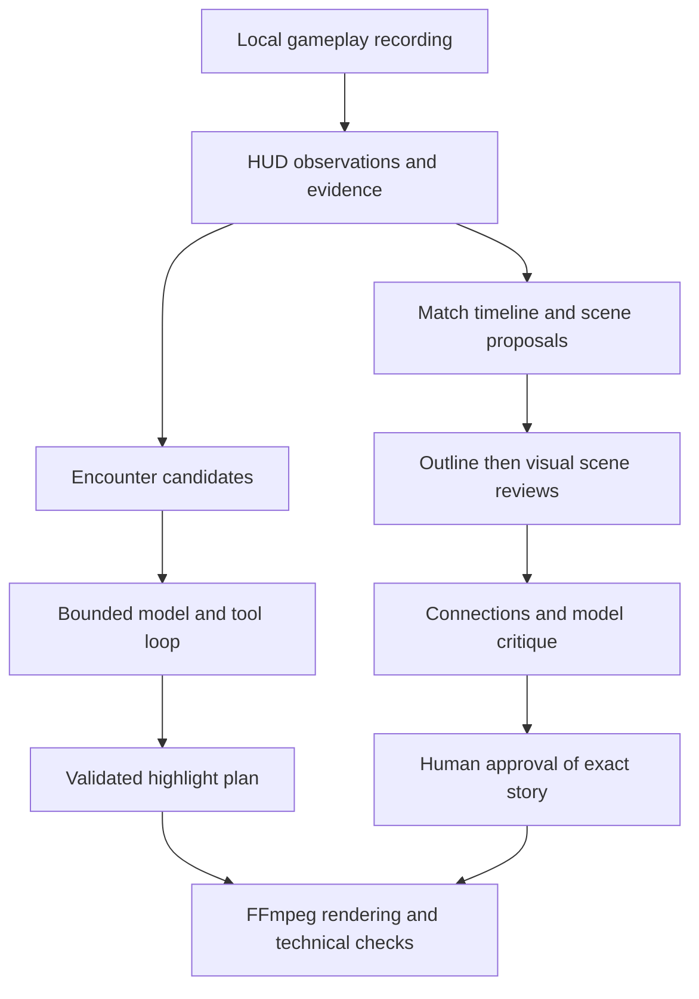

# Valorant StoryClip: project and viva walkthrough

Written from the current source code and local artifacts inspected on 20 October 2026. This guide explains the implemented system; historical planning documents describe earlier intentions and results. Course mapping uses common agentic AI and engineering topics because no syllabus was supplied. No new hosted-model request or gameplay export was performed to prepare this guide.

**1. Start with the problem and the few ideas everything depends on**

A gameplay recording contains images and audio over time. An edit is a selection of source intervals, together with instructions for arranging and displaying them. To make a useful edit automatically, the system needs to answer three different questions: where might something interesting happen, what is actually supported by the evidence, and which supported intervals belong together?

Your project divides that work between conventional software and a pretrained language/vision model. Conventional software extracts observations, proposes intervals, checks constraints, and renders video. The model makes editorial judgments using the supplied observations and sampled images. Python controls what gets executed.

That separation explains the architecture. Searching every frame with a large model would be expensive and slow. Selecting clips only by kill count would ignore setup, consequences, and the story across a match. Accepting any model answer without checking it would allow fabricated timestamps and references. Therefore the project first narrows the search with local perception, then uses bounded model decisions, then validates and renders.

An accurate project description is:

> Valorant StoryClip is a local video-editing prototype that combines calibrated HUD extraction with a bounded LLM tool loop for encounter selection and a structured, evidence-based workflow for match-story editing. It keeps decisions inspectable, validates edit constraints, and requires approval of the exact story before final export.

The code implements two products:

| Mode | Editing task | Main decision mechanism | Output policy |
|---|---|---|---|
| Moment Highlight | Select one continuous encounter | Model chooses evidence actions and submits boundaries | 30–60 seconds; marked as needing human review |
| Match Story | Connect early, middle, and late scenes | Host runs outline, scene reviews, connections, critique | Current planner chooses 3–5 beats, at most 175 seconds, with exact-plan approval |

The lower-level storyboard schema permits 3–10 beats for broader/legacy uses; the current story-first outline is narrower. The story renderer tolerates a small encoding-duration difference and rejects exports above 180 seconds. The planning target remains at most 175 seconds.



Read the guide in that dependency order: evidence first, decisions second, checks third, output last. Otherwise the model can appear to have capabilities that are actually implemented by Python or FFmpeg.

**2. What each file does**

| File | Responsibility | Main entry points |
|---|---|---|
| `app.py` | Streamlit entry point, source selection, highlight UI, routes to story UI | Top-level app |
| `storyclip/__main__.py` | Command-line parsing and orchestration | `main`, `run_story` |
| `storyclip/media.py` | Source metadata, frame extraction, portrait and story rendering | `probe`, `frame`, `render`, `render_story`, `render_preview` |
| `storyclip/detectors.py` | Calibrated HUD perception and scan caching | `ocr_words`, `feed_rows`, `read_player_kill`, `scan` |
| `storyclip/candidates.py` | Conservative repeat flags and heuristic encounter ranking | `flag_repeated_entries`, `propose` |
| `storyclip/agent.py` | Pi adapter and short-highlight agent controller | `invoke_pi`, `choose`, `Decision` |
| `storyclip/timeline.py` | Score sampling, reviewed anchors, temporal reconciliation, full-match timeline | `score_pass`, `validate_anchors`, `reconcile`, `build_timeline` |
| `storyclip/story.py` | Scene proposals, storyboard checks, labels, legacy assisted draft, comparison baseline | `propose_scenes`, `validate_storyboard`, `compilation_baseline` |
| `storyclip/planning.py` | Current typed match-story orchestration and bounded recovery | `choose_story`, `_inspect`, `_assign_core`, `_minimum_cuts`, `_assemble` |
| `storyclip/narrative.py` | Story claim schemas, evidence checks, critique gate, approval receipt | `validate_outline`, `validate_scene_review`, `narrative_checks`, `check_approval` |
| `storyclip/story_ui.py` | Timeline, storyboard/source review, preview, feedback, approval, export | `show_story` |
| `storyclip/transcript.py` | Source-bound speech import, optional local ASR, caption timing | `validate_transcript`, `transcribe_windows`, `remap_captions` |
| `tests/` | Controller, validation, UI, and synthetic real-media checks | Three unittest modules |

The `choose_story` in `story.py` is a wrapper around the implementation in `planning.py`. `StoryAction` and `STORY_SYSTEM` in `story.py` retain the older broad action protocol; they are not the protocol used by the current typed planner. Follow the live call path instead of assuming every declared class is active.

The JSON configuration files hold calibration, not learned parameters. `hud_config.json` specifies the player name, known visible names, crop rectangles, sampling rate, and low-health threshold. `score_config.json` specifies score crops and sample spacing. `portrait_layout.json` specifies the optional facecam crop.

**3. How the source enters the system**

The UI searches the project root for `.webm`, `.mp4`, and `.mkv` files. It probes the selected video and defaults to `runs/demo`. If that directory contains a scan for a different recording, it selects a source-specific run directory. The CLI auto-discovers `.webm` and `.mp4` files only when exactly one exists; there are currently two source recordings, so use `--video` explicitly.

`media.probe` runs ffprobe and returns the absolute path, duration, width, height, audio presence, file size, and modification timestamp. These become source identity fields. They help reject artifacts from the wrong or changed recording. This is metadata-based identity, not a hash of every source-video byte.

The calibrated source in `runs/demo` is the s0m Clove recording: 1,993.088 seconds, or about 33.2 minutes, at 1920 × 1080. The detector tracks the visible name `Me`. The other recording can be selected, but that does not make this calibration valid for it.

**4. How HUD perception works, step by step**

The scanner runs locally and makes no language-model request. FFmpeg decodes the video, samples it at two frames per source second by default, crops the kill feed and health display, rescales the crops to the calibration dimensions, and streams small combined images to Python as raw BGR bytes. Python reconstructs each image with NumPy.

The kill-feed calibration is `[1200, 85, 720, 135]` and the health calibration is `[575, 1003, 82, 47]`, each interpreted as x, y, width, height against a 1920 × 1080 reference. Coordinates scale with source dimensions. Scaling compensates for resolution differences; it does not solve changed HUD placement or overlays.

`feed_rows` converts the feed crop to HSV color space, looks for sufficiently saturated/bright red or greenish bands, and finds horizontal runs of active pixels. It accepts runs in a configured size range. This is hand-written image processing, not a trained gameplay object detector.

For each likely row, `ocr_words` converts the image to grayscale, enlarges it threefold, and invokes Tesseract with a single-line segmentation mode. Tesseract returns recognized words, x coordinates, widths, and confidence scores. The numeric health/score version also thresholds bright glyphs and permits digits only.

`read_player_kill` accepts a row only when it finds the configured player name in the killer-side region and a recognized other name in the victim-side region. It requires OCR scores of at least 35 for the player and 25 for the victim. Names are normalized by removing non-alphanumeric characters and lowercasing. These thresholds are heuristics, not calibrated probabilities.

This attribution rule matters. A visible player name somewhere in the feed does not establish that the player made the kill; the name could be on the victim side. Restricting positions and checking both names reduces that confusion. Restricting victims to known names also introduces a recall limit: unfamiliar names may be missed.

Persistent kill-feed entries remain visible for several sampled frames and may shift between rows. The scanner therefore tracks the killer/victim pair over time rather than treating each image row as a new event. A matching pair seen within two seconds updates the existing event's last-seen time and observation count. Near-identical row images can reuse OCR results, avoiding repeated Tesseract work.

At the end, two or more observations yield `consistent_ocr`; a singleton yields `needs_review`. Repeated observations can reuse a cached reading. Therefore `consistent_ocr` means temporal consistency under this detector, not multiple independent recognitions or human verification.

`flag_repeated_entries` adds a second safeguard. A close repetition of the same killer/victim pair within eight seconds of the earlier last-seen time becomes `repeat_needs_review`. It is kept as evidence but excluded from accepted candidate ranking. This avoids counting an OCR interruption as an extra elimination. A genuine repeat elimination after revival may also be flagged: the conservative choice trades some recall for fewer inflated multi-kill scores.

Each event includes an ID, first-detected timestamp, last-seen timestamp, attributed killer/victim, OCR text and score, observation count, HP context, quality status, and a saved feed crop. The timestamp is when the detector first accepted the visible entry; it can lag the actual game action.

**5. How health becomes a feature**

Health OCR accepts integer readings from 1 through 150 and treats unreadable or invalid values as unknown. A value must recur in a roughly 1.1-second recent window before it becomes an accepted displayed-health observation. Pixel-change caching avoids rerunning OCR on an unchanged health mask.

For a newly detected kill, the scanner looks backward for an accepted HP reading strictly before the detection timestamp and no more than one second old. If that reading is at most 40, it sets `low_health=True`.

Why preceding health? Health after a fight may describe its consequence rather than the condition under which the fight began. Why a short freshness window? Carrying old health through an unreadable HUD or perspective change can invent context. Why keep unknown separate from zero? Failure to read a number is not evidence of death.

This still has a timing limitation: a delayed kill-feed detection can join health from after the real elimination. Displayed health also excludes armor and other gameplay effects. Explain it as a provisional displayed-HP feature, not verified survivability or death detection. The current saved scan accepted no low-health kills.

**6. Candidate ranking: how the search space shrinks**

Only unflagged `consistent_ocr` events enter `candidates.propose`. Each accepted kill anchors a forward-looking cluster of kills over the following 15 seconds. The candidate normally begins 12 seconds before the anchor and lasts at least 45 seconds where the source allows it, with enough space after clustered events. End-of-source handling moves the beginning backward when needed.

The actual score is:

$$\text{candidate score}=3K+2L,$$

where $K$ is the cluster's accepted kill count and $L$ is its low-health kill count. Thus two ordinary accepted kills score 6; two accepted kills including one low-health kill score 8. These weights were chosen by the program, not learned through model training.

Candidates are sorted by score. A proposal is suppressed when its temporal intersection with an already selected proposal exceeds half the shorter interval. At most eight are returned by default. This overlap suppression helps produce distinct encounters instead of several slightly shifted versions of one fight.

The candidate's `event_ids` include accepted events throughout its full interval, not only the smaller scoring cluster. This distinction explains why a candidate may cite more events than contributed to its score.

No audio excitement score, headshot detector, clutch detector, or learned highlight classifier participates in this implemented formula. Some older plans mention broader possibilities; the code is the authority for the current system.

The event baseline simply chooses the first/highest-ranked candidate and uses its fixed boundaries. It is useful because it answers a research question: does adding the model improve decisions beyond what the heuristic already provides?

**7. The short-highlight agent: the clearest agentic component**

The model receives candidate summaries, source duration, a JSON schema, and accumulated tool history. It returns one `Decision` object with an allowed action, candidate ID, optional interval, evidence IDs, reason, and title. Pydantic rejects extra fields and non-finite numbers.

| Action | Python's behavior |
|---|---|
| `get_events` | Return event records in the requested candidate interval, including quality flags |
| `get_health` | Return changes in HP readings, retaining transitions to unknown and bounding the result size |
| `inspect_frames` | Extract and attach a few timestamped source images |
| `submit_clip` | Validate boundaries and evidence, then persist an edit plan |

The loop is: model proposes an action → Python validates and executes it → Python appends the result → model receives the updated context → model chooses again. The model chooses the next permitted action using previous observations. That is the basis for calling this component agentic.

The execution environment is narrow. The model does not receive a shell tool or arbitrary file access through this adapter. It cannot execute FFmpeg merely by writing a command in its answer. Python interprets only the allowlisted action protocol. The model generates the decision; the controller grants or refuses its execution.

`inspect_frames` samples the beginning, positions just after first/last detected events, and near the end. It supplies a few images, not continuous playback or audio. There can be fewer than four distinct timestamps after deduplication. These frames are enough to check some context but can miss a decisive fast action.

Limits are six total turns, two evidence requests, and one validation correction. The second validation failure ends the loop. When video is supplied, a frame-inspection action must have occurred before submission. Submission checks source bounds, 30–60-second duration, proximity to the candidate, nonempty evidence, candidate membership, and evidence timestamps inside the clip. A failed run is not silently relabeled as a successful agent baseline.

One implementation nuance: the current inspection gate checks that an inspection occurred somewhere in the trace; it does not explicitly require that the final candidate is the same candidate inspected. The saved demo does inspect its selected candidate, but that stronger invariant would be a worthwhile hardening change.

The current saved trace is an especially useful demonstration:

1. Turn 1: inspect `candidate-01`, source 420.5–465.5 seconds.
2. Turn 2: Python rejects the answer: `At least one event evidence ID is required.`
3. Turn 3: the model requests events; Python returns two consistent events and a flagged repeated Cypher entry.
4. Turn 4: the model submits 420.5–465.5, citing `kill-0007` at 432.5 and `kill-0008` at 445.0.

This shows observation, tool use, a concrete validation error, and correction. It does not expose private chain of thought. The saved `reason` fields are explanations of decisions, not proof of the model's full internal computation.

**8. How Pi connects the application to the model**

`invoke_pi` is an adapter: it translates a Python payload into a Pi CLI request, then translates Pi's JSON-line output into a Python dictionary. The configured provider is `openai-codex`; the current default model string is `gpt-6-luna`. These are observations of this repository's configuration, not a claim about global model availability or pricing.

The adapter writes the prompt to a file, attaches requested images, disables Pi's general tools/extensions/skills/context files, supplies a task-specific system prompt, and asks for JSON output. Authentication stays in Pi's own storage. The local application coordinates the task; model inference uses the configured remote provider. The `--offline` CLI flag should not be taken as evidence that the LLM runs on your computer.

It waits up to 150 seconds per subprocess invocation. It looks for the final assistant message, detects provider errors, excludes interim commentary/analysis blocks, and parses exactly one JSON value. A multiple-object reply such as `{}{}` fails parsing and is saved for diagnosis. A single outer Markdown code fence can be stripped, but the actual content must still parse as JSON.

This is a custom structured tool protocol built in Python. It does not establish use of provider-native function calling, MCP, LangChain, LangGraph, CrewAI, or AutoGen. A framework is not necessary to implement an agent loop.

The short-highlight adapter normally requests low thinking; the story planner explicitly requests medium. This is a request configuration passed to Pi, not access to hidden model reasoning and not a custom reasoning algorithm implemented by the project.

**9. Why a match story needs more than a high-scoring fight**

A match story asks what the initial situation was, what changed, and how it resolved. Ranking kill clusters only finds local activity. A convincing story may need quiet setup, a setback, and a teammate's finish. Therefore the story workflow builds a full-match timeline that preserves unknown and quiet intervals rather than discarding everything without kills.

`score_pass` samples the configured left/right score crops every 30 seconds, plus a near-end sample. It adds one midpoint sample around changed or unknown neighboring readings; this is bounded refinement, not an unlimited recursive search. It uses up to three worker threads for sampling.

`reconcile` accepts repeated neighboring readings only when their progression is plausible relative to the previous trusted reading. Isolated readings, regressions, and implausible jumps need review. A trusted score is a repeated accepted OCR score or a reviewed anchor.

Reviewed anchors are explicitly assisted inputs. Each anchor must match the source, have a valid timestamp/score, include an existing evidence image and review note, and use a valid team mapping/outcome if provided. A mapped victory must agree with the score ordering. The code validates those fields; it cannot prove that a person really inspected the image.

Team identity is local to the reviewed observation. A left/right score alone does not tell you which team is the tracked player's team, and a mapping must not be assumed to hold across side changes. Therefore the renderer can display neutral `HUD score 5-5` without claiming a lead. Team-specific `Victory | 13-11` needs a reviewed outcome and mapping.

`build_timeline` requires a full-source event scan. It combines scores, flagged events, optional speech, and a dictionary mapping evidence IDs to records. Between observation times it creates stable-score intervals, brackets containing a possible round boundary, or unresolved intervals. These are observation-derived intervals, not exact recovered rounds. Death records remain empty because an automatic death detector is unavailable.

`propose_scenes` creates opening coverage, several distributed match checkpoints, action scenes in each third where accepted kills exist, additional strong encounters, reviewed-anchor context, and an ending. It suppresses very similar starts and then sorts by time. Each proposal gets extra inspection context: 15 seconds before and 25 seconds after, clamped to source bounds.

This division matters: Python proposes possible places to look; the model decides which places can serve one story. The model can refine cuts within allowed context, but it does not freely search every possible interval in the recording.

**10. The current story planner, phase by phase**

The active workflow is in `planning.py`. It uses typed tasks rather than asking the model to manage every future stage in one response.

First, the outline request receives compact match context and available scene IDs. It returns a premise, viewer question, initial situation, important change, resolution, and 3–5 scene intents. Each intent has a role, question, and purpose. Python checks distinct known scenes, chronology, early/middle/late coverage, accepted core evidence, and coverage of the final result when known.

Next, Python assigns core citations to scenes and computes the minimum span needed to retain them. The ending can reserve known buildup before the final result. If core facts cannot fit within 60 seconds per scene and 175 seconds overall, the outline is rejected before expensive scene review. Earlier cuts reserve enough budget for later evidence instead of consuming everything at the start.

Then Python inspects each scene. `_inspect` extracts eight distributed samples plus important accepted events/reviewed anchors, with a reduction heuristic for larger sets. Important timestamps are preserved, so the code does not enforce one absolute fixed image count. Samples are labeled with frame IDs and source timestamps and added to timeline evidence.

The scene-review model receives those images, the story intent, relevant events/scores/speech, required evidence times, and cut limits. It returns a source cut, situation, action, consequence, usefulness, completeness, and uncertainty. Each of the three claims must cite an inspected frame inside its selected cut. Python checks that the scene stays in its inspection window, preserves required core facts, respects duration allocation, and follows earlier cuts.

The model can mark a scene insufficient. If enabled, the host can refine one uncertain interval using score samples every three seconds and event scanning at four FPS. If a scene still fails or cannot produce a valid cut, one scene-driven replan is available. This is controlled recovery, not an infinite search.

Once all scenes are reviewed, the connections request writes exactly one bridge for each adjacent pair. Each bridge has at most 130 characters and cites evidence in both scenes. Python assembles the storyboard and selects neutral or evidence-backed score/outcome overlays. The visible bridge uses viewer language; detailed citations remain in review data.

Finally, a separate critique request receives the storyboard, relevant evidence, and sampled frames within the actual cuts, including context frames not quoted by the editor. It checks setup, development, outcome, connectedness, claim support, and cut completeness. Passing requires verdict `pass`, all six checks true, and no findings. A rejected critique can trigger one revision; it cannot directly authorize export.

The critic uses the same configured model argument as the editor with a different prompt. Call it a separate critique stage or same-model review. It is not an independently trained judge, and several prompted roles do not by themselves establish a multi-agent system. Agreement can repeat the same underlying mistake.

There are up to three replies per phase, a global limit of 24 model requests, and up to three planning cycles. One scene-recovery revision and one critique-recovery revision have separate counters. Eligible provider failures get at most two retries with delays of two and four seconds, within the same reply/request limits. Authentication, quota, and other classified nonretryable failures stop instead of being presented to the model as bad editing.

The two budgets solve different problems: validation corrections ask the model to fix a bad answer; provider retries attempt to obtain an answer after a connection problem. Keeping the distinction makes diagnostics useful.

**11. Grounding, validation, and approval are different checks**

The system has several layers of confidence, each answering a different question:

| Layer | Question it can address | What it cannot guarantee |
|---|---|---|
| Pydantic schema | Are required fields and permitted values present? | The prose describes reality |
| Python constraints | Are IDs real, timestamps valid, cuts chronological, budgets respected? | Every cited image entails the claim |
| OCR consistency | Does a detected reading persist under the detector? | It is accurate game telemetry |
| Visual scene review | Does the model find sampled support for this beat? | Unsampled frames contain no contradiction |
| Model critique | Does another model request find factual/editorial problems? | Independent verification or audience engagement |
| Human review | Does the person accept the actual edit and its claims? | A statistical accuracy benchmark |
| ffprobe/output checks | Does the file have expected dimensions, duration, and audio? | Good storytelling or perfect audiovisual synchronization |

An evidence ID is a reference, not a magic truth certificate. Python can check that a cited frame exists at a timestamp in the cut. It generally cannot mechanically prove that a sentence about the frame is correct. This is why grounded generation still needs visual and human review.

Source cuts use half-open intervals $[a,b)$. The start is included; the end is excluded. A frame at 49.8 seconds needs an end strictly greater than 49.8. This prevents a claim from citing evidence that is outside the actual selected footage.

Approval creates a receipt containing the storyboard's SHA-256 fingerprint, timeline identity, time, and `approved_by: human_review`. Rendering recomputes the hash and rejects a missing/revoked receipt, changed plan, or wrong timeline. Changing a cut or explanation invalidates approval. Saving UI feedback revokes the existing receipt and sets revision requested.

This protects against accidental use of approval for a different edit. It is not a cryptographically signed identity or access-control service: local code/files and the CLI are trusted. The CLI approval command records approval after the operator invokes it; the software cannot prove they actually watched the footage. The UI checkbox is likewise an attestation, not measured viewing.

A full draft preview is allowed before approval only after a passing critique. It uses a distinct draft filename and a persistent `DRAFT PREVIEW - NOT APPROVED` watermark. Final export still requires the exact approved story. Moment Highlight has a review flag and review advice rather than this mandatory receipt gate.

**12. How rendering and time mapping work**

For a short highlight, FFmpeg seeks to the selected source start, extracts the interval, and encodes H.264 video plus AAC audio at 720 × 1280 and 30 FPS. With the calibrated layout it keeps a full gameplay panel and a separate facecam panel on a portrait background. Without facecam configuration it scales and pads the source. It does not perform automatic action tracking or a moving crop around the player.

For a story, each beat is rendered as one continuous source excerpt in chronological order. Individual segments share compatible video settings; audio is resampled and padded for assembly. The segments are concatenated, final audio is encoded as AAC, and total output is bounded by the plan duration. Original source audio content is preserved through the edit; the encoded bytes are not bit-identical to the original audio.

Overlays are generated by Python from accepted evidence. A score appears no earlier than its observation and expires after five seconds or an earlier accepted score change. A reviewed final-result overlay can remain to the end. This prevents a sampled score from being displayed as if continuously true across a later round.

The fundamental time mapping for a selected shot beginning at source time $s$ and output time $o$ is:

$$t_{output}=o+(t_{source}-s).$$

For example, the current second story shot begins at source 943.8 seconds and output 50.0 seconds. A source observation at 960.0 seconds belongs at output 66.2 seconds. The current fourth shot starts at source 1945.917 and output 121.5; the final anchor at 1980 appears at output 155.583 seconds.

The mapping JSON preserves source/output intervals, evidence, overlays, and explanations. That makes the final edit auditable: a viewer or evaluator can locate which original footage supports an output moment.

Rendering writes to a temporary directory, probes the temporary MP4, checks dimensions, duration tolerance, and audio presence, then replaces the final video. A failed encode/check does not overwrite the last good MP4. The mapping/SRT writes occur after the video replacement, so this is not a fully transactional database commit across every artifact.

**13. Optional speech and captions**

An imported transcript must carry the exact source identity and valid segments with start, end, and text. A nonnegative `offset_s` can translate window-relative times into original-source seconds. Segments receive stable IDs and remain labeled as needing review.

Local transcription is optional and requires a predownloaded faster-whisper model directory plus the optional dependency. This code uses CPU inference with int8 computation, English, voice activity filtering, and selected discovery windows. It never implicitly downloads a model. Having an RTX GPU does not mean this implementation uses it.

Only transcript segments fully contained in a selected shot are included; captions crossing a cut boundary are not automatically truncated by this path. `remap_captions` applies the source/output formula, and SRT output formats those output timestamps. FFmpeg can burn the SRT into the portrait edit.

The current demo timeline contains zero transcript segments and its current story render contains zero speech captions. Original speech can still be audible because source audio is retained. Automatic death extraction and generated narration are unavailable. A vision model's description of a visible elimination/spectating change is separate from an implemented automatic death-event detector.

**14. State, caching, and reproducibility**

The short agent's working state is its Python loop variables and explicitly supplied `tool_history`. Each Pi invocation starts without a persistent Pi session; context continuity comes from the payload Python sends. The story planner similarly passes phase-specific evidence, reviews, previous candidates, and feedback.

Files provide persistence across app reruns. `scan.json` stores the scan and manifest; `timeline.json` stores match context; plans, traces, feedback, approval, and mappings record later stages. Streamlit session state tracks UI choices, while durable facts are on disk. There is no database server in this implementation.

The scan cache identity includes source metadata, crop config, scan interval, sample FPS, and a hash of detector source code. Score sampling caches include source/config and timeline-module source. The model cache hashes the payload, model string, and system prompt; payload thinking is therefore included too. Identical cached requests avoid a new model call. Story planning/review caches have their own directories.

Caching is stored computation, not model training. Human feedback is saved and supplied as future prompt context, not used for backpropagation. Evidence lookup is by IDs/timestamps, not embeddings or nearest-neighbor vector search. It is reasonable to discuss evidence retrieval and application memory; calling this a conventional vector-RAG pipeline or a self-training agent would misdescribe it.

Cache caveats matter. Source identity is metadata-based, not a content checksum. A hosted model behind a fixed name can change. Not every helper-code change is represented in every cache key. The UI can display an existing scan after checking source/config without re-running the scanner's full code-version manifest check. The run folder mixes historical and current artifacts, so use hashes and identities rather than filenames alone.

Scanning less often reduces OCR work but does not eliminate video decoding cost. The current full scan took about 8.8 minutes even though only 3,986 HUD samples were processed. Parallel score/frame sampling uses threads to launch bounded media tasks; this is software concurrency, not evidence of a multi-agent AI architecture.

**15. What is currently proven by your local artifacts**

The following values were read or checked on 20 October 2026. Scan/model timings below are saved run measurements, not a new complete processing benchmark.

| Item | Current evidence |
|---|---|
| Full calibrated source | 1,993.088 seconds, 1920 × 1080, with audio |
| Saved scan | 3,986 sampled frames; 526.93 seconds elapsed |
| Raw attributed event records | 25 |
| Conservative event statuses | 8 consistent, 13 needing review, 4 close-repeat flags |
| Candidate encounters | 6 |
| Accepted health readings | 3,273 of 3,986 samples, about 82.1% coverage |
| Current moment edit | 420.5–465.5 source seconds; 45 seconds |
| Moment model / trace | `gpt-6-luna`; frame inspection, validation rejection, events, submission |
| Moment baseline comparison | Same interval; current highlight and baseline MP4 SHA-256 hashes are identical |
| Timeline | 168 score observations, including 8 reviewed anchors; 19 scene proposals; assisted |
| Speech | 0 current transcript segments |
| Current match story | 4 beats; 168.583 seconds planned; 168.586 seconds exported |
| Story critique | Saved pass, six checks true, no findings |
| Story approval | Current receipt matches current storyboard and timeline |
| Current final video | 720 × 1280, H.264 at 30 FPS, AAC audio; mapping matches current plan |
| Automated verification in this session | 71 tests passed in 12.180 seconds |

The current story cuts are:

| Role | Original-source interval | Assembled-output interval |
|---|---|---|
| Setup | 0.0–50.0 | 0.0–50.0 |
| Action | 943.8–990.0 | 50.0–96.2 |
| Development | 1369.8–1395.1 | 96.2–121.5 |
| Outcome | 1945.917–1993.0 | 121.5–168.583 |

The story trace records 17 model requests across an initial attempt and a critique-driven revision. It includes rejection of tentative/repeated event evidence and corrections for frame citations outside the chosen cuts. That is useful evidence of the controller enforcing constraints on actual saved model responses.

Several historical details must not be repeated as current results. `RUN_STATUS.md` includes earlier 30-second and three-scene runs; the latest files above supersede those descriptions. `story_v2_run_state.json` and the storyboard's status still say `awaiting_human_review`, although the separate approval receipt is valid and a matching final export exists. Approval/export code does not update that planning status, so inspect the receipt and mapping too.

The 119.526-second watermarked `match_story_draft_preview.mp4` belongs to an older plan: its hash does not match the current four-beat storyboard. The UI is designed to hide a mismatched preview. Do not demonstrate that older preview as the current approved edit.

The current moment highlight and baseline are byte-identical. This is an honest negative result for added selection/rendering benefit on this example. The agent did gather evidence and recover from an error, but this saved outcome does not establish superiority over the baseline.

One remaining semantic review point: the current second scene's uncertainty text says that no individual elimination is claimed, while its outline/purpose and some other text name eliminations. The structural checks pass but do not reconcile every sentence's meaning. Review that scene and align its explanations before claiming the prose is entirely consistent. This guide does not modify or reapprove the story.

**16. What the tests establish, and what evaluation still needs**

The suite covers event-repeat handling, candidate selection, malformed model replies, final-response parsing, evidence IDs and bounds, phase budgets, retry limits, timeline/source binding, narrative connections, approval invalidation, UI feedback, and renderer behavior.

The media integration test creates a small synthetic video with red/green/blue sections and different audio frequencies. It checks that selected colors appear in the correct order, retained audio has the expected frequencies, caption times move correctly, and a draft watermark is visibly present. That is stronger evidence than merely checking that an MP4 file exists.

Many planner tests mock model responses deliberately. They test what Python does when the model returns particular decisions, not how often a live hosted model returns good decisions. Running 71 tests successfully establishes that those tested cases pass on this environment; it does not mean 71% or 100% gameplay accuracy.

To evaluate the full AI system, label reserved recording segments and compare detections with ground truth at a declared timing tolerance. Useful metrics are:

$$\text{precision}=\frac{TP}{TP+FP},\qquad \text{recall}=\frac{TP}{TP+FN}.$$

Here $TP$ is a correctly detected labeled event, $FP$ is an incorrect detection, and $FN$ is a labeled event missed by the system. Account for duplicates separately and specify timestamp tolerance. The video's title saying “35+ eliminations” is not a timestamped annotation set and cannot be used alone to calculate recall.

Measure HP accuracy on manually readable crops separately from HP coverage. The 82.1% figure describes how often the detector accepted a reading, not how often it was correct. Measure candidate coverage: how many human-marked interesting moments survive into the shortlist? An agent cannot select a moment excluded from all permitted candidates.

For story quality, ask blinded reviewers whether they can identify the setup, meaningful change, and outcome; count unsupported claims; compare duration-matched story and encounter compilations; and repeat on more than one recording. Record first-run versus cached runtime, model requests, correction frequency, and failure reasons. A passing same-model critique is not a human engagement score.

The comparison compilation is intentionally neutral: it selects kill-ranked encounters, orders them chronologically, and matches the story duration where enough distinct encounters exist. It bypasses story requirements because it is explicitly a baseline rather than a narrative story. That creates a more useful comparison than simply contrasting a two-minute story with a 30-second clip.

**17. How to explain the course concepts precisely**

| Course concept | Where your implementation demonstrates it | Boundary to state |
|---|---|---|
| Agent and environment | Highlight model chooses bounded actions; Python returns observations | No unrestricted desktop/browser/game control |
| Tool use | `Decision.action` dispatches event/health/frame queries | Custom JSON protocol rather than automatically provider-native function calling |
| Orchestration | Python maintains state, enforces order, budgets, and termination | Model alone is not the complete system |
| Planning/decomposition | Story thread → intents → reviewed cuts → connections | Stage order is authored in code |
| Feedback and repair | Validation error + previous candidate produce a corrected reply | Context adaptation, not model-weight learning |
| Reflection/evaluation stage | Critique can reject and trigger one revision | Same configured model, correlated errors possible |
| Grounding/provenance | Claim IDs lead to source timestamps and evidence images | Citation existence does not prove semantic truth |
| Multimodality | Model receives text plus selected source images | No continuous-video or direct audio input in these calls |
| Human oversight | Hash-bound story approval and feedback revocation | Local trusted-user receipt, not identity authentication |
| Reliability engineering | Schemas, finite bounds, retries, atomic video replacement | Prototype lacks production-scale job isolation and security hardening |
| Observability | Saved traces, errors, metrics, prompts, plans, output maps | Reason text is not private chain of thought |
| Evaluation/baselines | Event-only and duration-matched compilation comparisons | No established broad accuracy/preference advantage |

Using the common distinction between model-directed agents and code-directed workflows, your application combines both. The short highlight selection is the clearest bounded agent. The current longer-story implementation is better described as a host-orchestrated LLM workflow with planning, evidence inspection, critique, and recovery. This does not make it less relevant to an agentic engineering course: deciding what the model should control is itself an engineering decision. [Architectural distinction](https://www.anthropic.com/engineering/building-effective-agents)

Its action/observation cycle resembles part of ReAct, whose original method interleaves reasoning traces and actions. Do not claim the repository implements the exact original ReAct prompting method merely because it has tools and a loop. [Original ReAct paper](https://arxiv.org/abs/2210.03629)

Same-model feedback and revision can improve a candidate without training a new model; Self-Refine is a research example of that distinction. Your code uses a simpler project-specific critique workflow, not a demonstrated reproduction of that paper's full method. [Self-Refine](https://arxiv.org/abs/2303.17651)

Evidence attribution concerns whether a statement is supported by supplied sources. It remains different from unrestricted truth checking, especially when the supplied observations are incomplete or wrong. [Attribution framework](https://aclanthology.org/2023.cl-4.2/)

**18. Professor questions and defensible answers**

**“What did you actually build, beyond calling a model?”** You built the evidence-extraction and temporal-tracking pipeline, candidate search space, tool interface/controller, story decomposition, validators, provenance, approval mechanism, renderer integration, and tests. The model is a pretrained dependency used for editorial decisions.

**“Where exactly is it agentic?”** In `agent.choose`, the model selects its next permitted evidence action based on previous results and can revise a rejected submission. The surrounding application and typed story stages are controlled by Python.

**“Why not just use the highest kill count?”** Kill count finds activity but cannot reliably decide whether the beginning establishes context or whether the ending explains what happened. The model can inspect context and choose/refine a cut. However, the current moment example agrees exactly with the baseline, so the added benefit is not demonstrated on that example.

**“Does the model watch the entire match?”** No. Local software scans the full recording. The model receives an event/score summary and sparse images for investigated scenes. It does not receive every frame or hear the soundtrack in these requests.

**“Why can the final video have speech if the model never heard it?”** FFmpeg preserves the original source audio for selected intervals. Editing audio is separate from understanding it. Optional transcripts can add text evidence and captions, but this current demo has none.

**“How do you prevent hallucination?”** Use restricted inputs/actions, explicit uncertainty, accepted evidence IDs, timestamp checks, source identity, visual review, critique, and human approval. These reduce unsupported output and reject certain invalid plans; they do not eliminate semantic mistakes.

**“What happens if OCR is wrong?”** Its errors can propagate into ranking and model context. Temporal consistency and saved crops help review but do not create ground truth. Calibration and held-out labeled evaluation remain necessary.

**“Did you train or fine-tune the model?”** No custom LLM training/fine-tuning is implemented. The project uses existing OCR and language/vision models, hand-written perception rules, and prompt/controller engineering.

**“Is this multi-agent or RAG?”** It has multiple prompted stages using the same model, coordinated by one application. It retrieves evidence by explicit IDs/timestamps. It does not implement a demonstrated autonomous multi-agent architecture or embeddings/vector-retrieval pipeline.

**“Why use typed phases instead of one big autonomous instruction?”** Phase-specific schemas and validators make failures local and corrections concrete. The repository's historical failure involved responses spanning multiple actions and chronology errors. Typed phases let Python own progression and report the actual failure.

**“Can a critique pass guarantee the story is good?”** No. It is another model judgment over sampled evidence. Human review checks the continuous edit, and blinded evaluation is needed to establish audience preference.

**“What is your memory?”** Python's tool history is working context; local JSON files persist observations, plans, and feedback; caches store prior computation. These do not update model weights.

**“What is the stopping condition?”** A valid submission ends the highlight loop; a passing reviewed story ends planning; receipt validation permits final export. Budgets, nonretryable errors, failed corrections, and rejected revisions also terminate with explicit failure.

**“How does human approval stay attached to the right edit?”** A receipt records the full storyboard fingerprint and timeline identity. The renderer recomputes and compares them. Editing the approved plan invalidates its receipt.

**“What is your accuracy?”** No broad detector accuracy is established. There are scan coverage figures, inspectable outputs, and 71 passing software tests. Precision, recall, caption accuracy, and editing preference require labeled evaluation.

**“What would you improve first?”** First label reserved footage and measure detector/candidate failures. Then fix semantic inconsistencies, strengthen inspection-to-selected-candidate checks, improve timing around actual eliminations, and evaluate story completeness with humans. More agents or a vector database are not automatically the highest-value next steps.

**19. A demonstration you can explain as you operate it**

Start Streamlit from the project directory:

```bash
.venv/bin/python -m streamlit run app.py
```

Select the supplied s0m Clove recording, whose HUD is calibrated. Explain that two local videos exist but the current detector is tailored to this one. Show the cached scan and one feed crop alongside its event record. Point out quality states rather than presenting all 25 records as verified kills.

In Moment Highlight, show the candidate ranking and the actual four-turn trace. Emphasize the rejected submission without IDs, the subsequent event tool result, and the valid final interval. Play the 45-second output. If showing the baseline, disclose that the two current files are identical: this is a useful comparison result, not a reason to invent a quality gain.

In Match Story, show the timeline's assisted status and eight reviewed anchors, then the current four-scene storyboard. Pick one scene and follow its explanation → evidence ID → timestamp → source image → final output position. This demonstrates provenance more clearly than reading every JSON field aloud.

Show the passing critique, matching approval receipt, and final 168.586-second export. Explain why a change to the plan requires approval again. The old watermarked three-scene draft is from a different plan. Do not click fresh planning just to prove that an already saved result exists: an uncached request contacts the configured provider and may take time. Label any cached demonstration honestly.

For a CLI-only cached selection inspection, use explicit `--video` because two files are present. For a fresh run in a separate output directory, the general command shapes are:

```bash
.venv/bin/python -m storyclip scan --video '/absolute/path/to/recording.webm' --out runs/new-demo
.venv/bin/python -m storyclip run --video '/absolute/path/to/recording.webm' --out runs/new-demo
.venv/bin/python -m storyclip story-run --video '/absolute/path/to/recording.webm' --out runs/new-demo
```

Replace the placeholder path. `run` can invoke the model and render a highlight; `story-run` stops at a draft. Reviewed anchors/transcripts must belong to that exact source. After genuinely reviewing an acceptable current storyboard, the CLI provides `story-approve` and `story-render`; do not use approval as an automatic setup command.

The verification command is:

```bash
.venv/bin/python -m unittest discover -s tests -v
```

For revision, request changes through the UI, save feedback, replan, review the new exact storyboard, and approve it. Do not manually edit an approved JSON plan while expecting its old approval to remain valid.

**20. Practical limits and the right next engineering steps**

The principal limitations follow from the architecture: calibrated crops/names limit generalization; sparse perception can miss action; consistent OCR can still be wrong; candidate filtering limits what the agent can find; identical-model critique can repeat mistakes; and local file state can accumulate stale artifacts. There is no established detector benchmark, audience preference result, direct audio comprehension, or automatic death detector.

The UI runs substantial work synchronously. A multi-user production service would need durable jobs, concurrency-safe run isolation, progress/cancellation, resource limits, stronger artifact/version manifests, and clearer status transitions. Current broad dependency constraints and a short direct-package lock list are useful setup aids, but not a complete reproducible environment specification for every Python package and system binary.

The prompt says evidence is data rather than instructions, and Pi general tools are disabled. Those are meaningful defenses against unwanted behavior from source text. They do not prove prompt-injection immunity. Keep the stronger claim narrow: execution is restricted by the application's own action dispatch and validators.

Prioritize measurement before architectural expansion. Build a small annotated evaluation set, quantify misses/duplicates/timing, compare agent and baseline across more examples, and assess whether a viewer can understand each edit. Those results would tell you whether the next improvement belongs in perception, candidate generation, scene selection, semantic review, or rendering.

The central contribution you can defend is the complete connection between uncertain perception, bounded model decisions, executable checks, inspectable provenance, and a real media artifact. Every part of the demonstration should make one of those connections visible.
